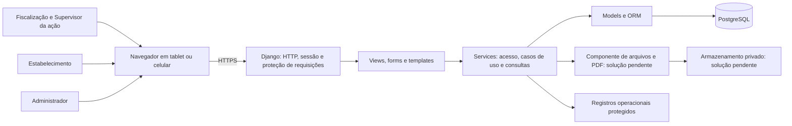

# Arquitetura do Sistema de Avaliação de Segurança Alimentar

- **Status:** proposta de detalhamento para revisão, originada na Etapa 3; referências atualizadas na Etapa 8.
- **Data:** 10/11/2026.
- **Base:** [PRD 0001](prd/0001-sistema-avaliacao-seguranca-alimentar.md), [decisões confirmadas](decisoes-confirmadas.md), [pendências](pendencias.md) e fontes F003, F005, F007 e F008 do [índice](referencias/README.md).

Este documento define responsabilidades e limites para orientar as specs futuras. A fundação da aplicação alimentar ainda não está implementada; esta entrega altera somente documentação e preserva o `.env`. O blog é referência de organização, sem migração de seu código ou banco.

As escolhas já confirmadas permanecem válidas. O detalhamento técnico apresentado aqui e a organização proposta precisam de revisão; sua redação não aprova políticas abertas nem o PRD como um todo.

## Base confirmada e propostas

| Tema | Situação | Referência |
|---|---|---|
| Python com Django e PostgreSQL | Confirmado; versões pendentes | DC003, P001, ADR 0001 |
| Web em tablets e celulares; hospedagem remota/nuvem | Confirmado; dispositivos e provedor pendentes | DC004, P015, P019 |
| MVT, Django Templates, views derivadas diretamente de `View`, services sem HTTP | Confirmado; fronteiras detalhadas abaixo | DC005 e DC006, ADR 0002 |
| Usuário customizado `AbstractUser`, nome de usuário/senha e sessão Django | Base confirmada; campos e políticas pendentes | DC007, P002, P014, ADR 0003 |
| Online, confirmação do servidor e retentativa sem duplicidade | Confirmado; mecanismo e prazos pendentes | DC018 e DC019, P020, ADR 0004 |
| Autorização contextual e supervisão por ação | Confirmado; representação e autoridades pendentes | DC008 a DC013, P002 a P006, ADR 0005 |
| Checklist, resultados, termos e histórico preservados | Confirmado; política detalhada pendente | DC011 a DC020, P009 a P013, P017, ADR 0006 |
| Uma aplicação Django organizada por áreas do domínio | Recomendação ainda não aprovada | F007, ADR 0007 |
| Backend nativo de sessões no servidor com PostgreSQL | Recomendação nova da Etapa 5, ainda não aprovada | Spec 0002, ADR 0008, P014/P015 |
| Separação lógica das áreas e coordenação de banco/arquivos | Detalhamento técnico proposto; sem esquema físico aprovado | P002, P003, P016 e seções seguintes |

## Contexto e componentes

A proposta inicial usa uma aplicação Django como ponto de entrada para páginas, operações e acesso autorizado aos arquivos. PostgreSQL guarda os registros oficiais. Um componente de armazenamento guarda os arquivos; sua tecnologia e localização permanecem abertas. Este diagrama apresenta responsabilidades lógicas, não uma topologia contratada.

O banco, o armazenamento e os registros operacionais ficam fora do acesso público direto. Serviços externos, balanceamento, filas e quantidade de processos não foram escolhidos. Uma implantação remota não exige, por si só, microserviços ou frontend separado.

## Responsabilidades das camadas

| Camada | Responsabilidade | Limite |
|---|---|---|
| URLs, middleware e sessão | Encaminhar requisições e executar os controles de transporte e identidade do framework | Não decidir cancelamento, correção ou pontuação |
| View | Herdar diretamente de `View`, receber HTTP, obter o ator autenticado, validar entrada via form, chamar service e produzir resposta | Sem consultas explícitas da aplicação ao ORM ou regras de negócio; mixins de acesso são admitidos |
| Form | Validar formato, presença e conversão dos dados de entrada e associar erros aos campos | Não autorizar ato oficial nem gravar a inspeção por `form.save()` |
| Service | Consultar e alterar dados, verificar autorização contextual e invariantes, coordenar transação, versões e auditoria | Não receber `request` nem retornar resposta HTTP; não depender de templates |
| Model e restrições do banco | Representar persistência, relacionamentos e integridade estrutural | Não conduzir aprovação, cancelamento, recálculo ou envio como efeitos ocultos de `save()` |
| Template e interação da página | Apresentar dados e erros, permitir preenchimento e indicar o estado do envio | Não decidir acesso, fazer cálculo oficial ou considerar pendente como salvo |
| Componente de arquivos/PDF | Executar armazenamento e geração sob coordenação do caso de uso | Não decidir acesso por endereço de arquivo nem alterar o resultado da inspeção |

O fluxo normal é View → Form → Service → ORM/Model. O service recebe o ator obtido pelo servidor, os dados validados e as referências necessárias. Validar o formato de uma referência não prova que o ator pode usá-la. A autorização e as regras de estado voltam a ser verificadas no caso de uso.

Como proposta de contrato, serviços de consulta devem preparar os dados necessários à tela e evitar carregamentos implícitos em templates. A spec escolherá entre objetos preparados, listas e estruturas de retorno; não há padrão de DTO, assinatura de método ou classe de service imposto nesta etapa. A view traduz falhas previsíveis em mensagem/resposta adequada sem expor dados internos. Os códigos e contratos de erro serão definidos nas specs.

### Exceções e comportamento do framework

A regra de ORM centralizado refere-se às consultas e escritas explícitas da aplicação. Consultas internas de autenticação, sessão, permissões, validação de `ModelForm`, administração e migrações não precisam ser reimplementadas em services. Essa exceção não permite inserir regras de inspeção nesses caminhos.

Login e logout que operam sobre a sessão ficam na view, como já confirmado. A exigência de herança direta de `View` aplica-se às views próprias da aplicação; não exige reescrever as views internas do framework ou o Django Admin. A [Spec 0002](specs/0002-autenticacao.md) propõe um form baseado em `AuthenticationForm`: seu recebimento de `request` e uso interno da autenticação são exceções nativas admitidas, sem permitir HTTP em services ou consultas explícitas de negócio nas views.

Uma validação de formulário ou uma consulta de tela pode ficar desatualizada antes da gravação. As invariantes decisivas devem ser verificadas novamente no service e, quando aplicável, protegidas por transação e restrições de banco. Signals e métodos de model não devem esconder o fluxo central de aprovação, cálculo ou emissão.

### Django Admin

O Admin é uma entrada administrativa técnica, não o perfil Administrador do produto. `is_staff`, superusuário técnico e perfil de negócio não são equivalentes nem concedem autoridade para aprovar uma fiscalização.

O ciclo interno de consulta e validação do Admin pode usar o ORM do framework. Filtros explícitos de escopo, consultas próprias e ações de negócio devem chamar os services pertinentes. Edições, exclusões em lote e ações administrativas não podem contornar autorização, versão ou auditoria.

Proposta para modelos com invariantes críticas: manter edição/exclusão direta indisponível até existir integração explícita com o mesmo caso de uso. Não basta chamar um service e depois permitir uma segunda gravação automática divergente. A extensão de usuários precisa respeitar os mecanismos de senha e sessão do Django; isso não autoriza editar diretamente dados críticos da inspeção.

## Áreas lógicas e propriedade dos dados

As áreas abaixo são uma proposta de responsabilidade. Não correspondem a apps obrigatórios, diretórios criados, tabelas ou relações físicas já aprovadas. A [Spec 0001](specs/0001-fundacao-tecnica.md) detalha a estrutura mínima candidata da fundação, ainda Proposta; as demais áreas serão introduzidas conforme as specs solicitadas.

| Área lógica | Dados e responsabilidade principal | Relações que precisam de coordenação |
|---|---|---|
| Identidade e acesso | Usuário, perfil-base e vínculos de acesso | Cadastro do estabelecimento e designações de supervisão |
| Estabelecimentos | Identificação e situação cadastral da unidade | Participação nas inspeções; inativação preserva histórico |
| Fiscalização e execução | Inspeção, equipe, respostas, irregularidades e referências de evidências | Checklist inicial, resultados e pedidos de decisão |
| Checklists e avaliação | Conteúdo versionado, regras e cálculo do resultado | Usa respostas oficiais e preserva regras originais |
| Autorizações | Solicitação, justificativa, decisão e escopo autorizado | Não aplicar mudança sem revalidar autorização e estado |
| Documentos e arquivos | Recebimento, autoria/origem, metadados e versões dos termos | Distingue anexo do estabelecimento, evidência fiscal e termo emitido |
| Auditoria | Eventos oficiais com autoria e relação entre decisão e efeito | Gravação consistente com o ato; retenção e acesso em P017 |
| Consultas e indicadores | Leituras filtradas e agregação autorizada | Não cria uma segunda fonte oficial de avaliação |

O significado de ação e sua relação com inspeção continuam em P003. Não será fixada uma relação de um para um ou de um para muitos neste documento. A designação de supervisor precisa de escopo e histórico, sem um booleano global que conceda poder sobre todas as ações.

Na proposta de monólito modular, uma área usa contratos de service da área responsável em vez de reproduzir suas regras. O caso de uso coordenador torna explícitas as dependências; não se introduz barramento de eventos, repositório genérico ou camada comum para esconder ciclos. Referências persistentes e o limite exato entre apps dependem das specs e do modelo de dados.

## Acesso e fronteiras de confiança

Identidade vem da sessão validada pelo servidor. IDs, perfis e autoria enviados pelo navegador não são prova de identidade ou autoridade. Aplicar verificação de perfil, vínculo, situação e escopo nas consultas, alterações e downloads, incluindo entradas pelo Admin ou por comando futuro.

Supervisor continua fiscal designado por ação. Participar de uma equipe, iniciar uma inspeção ou possuir acesso administrativo técnico não designa supervisão automaticamente. Quem designa/aprova, substituição, vigência e autoaprovação permanecem em P004 e P005; a arquitetura não concede esses poderes.

O estabelecimento fica limitado aos próprios envios e resultados finais liberados. Anexar documento não libera avaliação interna nem modifica nota. Arquivos precisam da mesma decisão de acesso que os registros aos quais pertencem; não devem ser públicos por conhecer o endereço.

Para a aplicação com sessão, preservar a proteção de requisições do Django e manter consultas de leitura sem efeitos oficiais. A proteção CSRF não substitui a autorização contextual. Referência técnica: [proteção CSRF do Django](https://docs.djangoproject.com/en/stable/ref/csrf/). A [Spec 0002](specs/0002-autenticacao.md) detalha os contratos candidatos de login, logout, redirecionamento e falhas de sessão. O [ADR 0008](adr/0008-sessoes-no-servidor-com-postgresql.md) recomenda backend de sessão no servidor para verificar invalidação após logout; não é decisão confirmada. Configuração de cookies, tentativas, recuperação, revogação global e expiração continuam abertas em P014/P015; a spec não escolhe esses valores.

## Estado oficial, aprovação e envio

Tratar separadamente três dimensões: situação oficial da inspeção, situação de uma solicitação de autorização e situação do envio na interface. Pedido pendente não significa inspeção cancelada; arquivo escolhido não significa recebido; presença de internet não significa confirmação do servidor.

O fluxo confirmado admite atribuição administrativa ou início direto, execução e conclusão confirmada. Cancelamento em andamento é uma operação autorizada com justificativa e histórico. Correção posterior à conclusão cria uma revisão rastreável; não reabre automaticamente a inspeção para edição livre. Geração de termo e liberação do resultado são etapas distintas da conclusão.

A lista definitiva de estados e transições será detalhada nas specs. Adiamento, reanálise, bloqueio durante análise e retomada permanecem abertos em P006 a P008. O bloqueio de conclusão por obrigatórios vazios ou envios pendentes/falhos continua proposta em RF014.

## Transações, concorrência e confirmação

Como detalhamento proposto, o service coordenador delimita a transação das alterações dependentes: verificar estado/autorização, aplicar mudança, registrar resultado pertinente e gravar o evento oficial. Se a transação falhar, não declarar a operação salva. Não substituir auditoria oficial por uma mensagem de log fora da alteração correspondente.

Conflitos entre fiscais precisam de detecção e resposta que preserve o contexto, sem sobrescrita silenciosa. Bloqueio, revisão otimista, restrições e isolamento serão escolhidos nas specs; não estão aprovados nomes de campos, tipos de chave ou algoritmo de concorrência.

O servidor pode confirmar a gravação e a resposta se perder no caminho. A retentativa deve reconhecer a mesma operação e devolver um resultado coerente, com autorização atual e sem outro efeito oficial. Escopo da identificação, comparação do conteúdo, concorrência e prazo de reconhecimento dependem de P020. O intervalo da tentativa e o mecanismo no navegador também permanecem abertos.

Um POST com redirecionamento, botão desabilitado ou teste sequencial de envio duplo não resolve sozinho esse problema. A interface precisa tratar a ambiguidade e preservar o conteúdo da página aberta enquanto aguarda confirmação, mesmo quando a perda de comunicação ocorre durante o envio. Não há inspeção completa offline nem armazenamento persistente aprovado.

Referência técnica: o Django oferece transações `atomic`; ações em `on_commit` executam depois da confirmação e sua falha não desfaz a transação já concluída. Um callback não deve ser tratado como garantia de processamento posterior. A necessidade de registro durável de tarefas e recuperação será avaliada antes de escolher fila ou agendador. [Transações do Django](https://docs.djangoproject.com/en/stable/topics/db/transactions/).

## Checklist, resultado e histórico

Desde o início, a inspeção mantém o conteúdo e as regras que sustentaram sua avaliação. Nova publicação não altera inspeções iniciadas. A escolha entre referência a versão imutável e cópia dos dados depende de P009; uma referência sem preservação do conteúdo não satisfaz essa regra.

Uma correção autorizada registra o anterior, o novo, justificativa, decisão, executor e momento. Quando afetar a avaliação, recalcular automaticamente com as regras originais e preservar os dois resultados. Precisão, Não se aplica, pesos e classificação dependem de P010.

Preservar cada termo emitido e ligá-lo ao resultado/revisão pertinente. Nova versão ou retificador não sobrescreve o original. Numeração, vigência, liberação, anulação e assinatura dependem de P012 e P013. A trilha oficial e os registros operacionais têm finalidades distintas; limites de acesso, retenção e proteção não são definidos por manter um campo genérico de log.

## Arquivos e geração de PDF

Acesso privado e preservação são requisitos; a solução de armazenamento e a biblioteca de PDF permanecem em P016. O desenho deve distinguir evidência fiscal, documento do estabelecimento e termo emitido, mantendo origem, autoria, vínculo e confirmação.

Proposta de coordenação: só apresentar um arquivo como recebido quando seu conteúdo e metadados estiverem consistentes e aceitos. Tratar recebimento parcial, arquivo sem vínculo e vínculo sem arquivo disponível. A transação do banco não torna o armazenamento de arquivos automaticamente atômico; serão necessários recuperação e tratamento dos resíduos conforme a estratégia escolhida.

Gerar PDF a partir da revisão confirmada, com identificação da emissão. Falha de geração não apaga a inspeção. Retentativa não emite outro termo indevidamente e não troca os dados de uma emissão anterior. O modo síncrono ou posterior, o controle durável da solicitação, o processamento concorrente e a reexecução serão especificados antes da implementação.

Validar formato, tamanho e conteúdo dos arquivos no servidor, com limites ainda não definidos. A escolha de entrega pelo Django ou mecanismo privado do provedor precisa preservar a autorização. Não estão escolhidos armazenamento local em produção, S3, links assinados, Celery, Redis ou outro serviço.

## Operação e qualidade

Recomenda-se separar configuração por ambiente, manter segredos fora do conteúdo distribuído e permitir investigação com contexto da operação sem credenciais ou dados sensíveis desnecessários. Banco e armazenamento precisam de controle de acesso e recuperação coerente. Restaurar só o banco não prova a recuperação das evidências e termos.

Provedor, domínio, execução, implantação, monitoração, retenção, backup, RPO/RTO e responsáveis permanecem em P015, P017 e P018. Nenhum valor de disponibilidade, capacidade ou tempo de resposta foi assumido. A documentação consultada do Django apoia conceitos; não seleciona a versão do projeto.

Templates com interação complementar no navegador são compatíveis com o padrão confirmado. A estratégia precisa ser validada em formulário extenso, câmera/seleção de arquivo e perda de comunicação; biblioteca de interface e padrão de requisições ainda não foram escolhidos. Homologação e acessibilidade dependem de P019.

## Viabilidade, riscos e validação futura

A proposta é tecnicamente viável em princípio com a base escolhida. Não existe implementação ou medição que comprove desempenho, custo operacional ou usabilidade em campo. As principais incertezas são de regras e coordenação de falhas, além da infraestrutura ainda não escolhida.

| Risco ou dúvida | Como reduzir ou verificar | Dependência |
|---|---|---|
| Acúmulo de regras em view, form ou Admin | Revisar fronteiras e testar o mesmo caso de uso por entradas distintas | ADR 0002, Etapas 4 e 7 |
| Privilégio global indevido | Validar acesso entre ações e estabelecimentos e designação revogada | P002 a P005, Etapa 6 |
| Gravação repetida ou conflito após reconexão | Simular confirmação com resposta perdida, concorrência e conteúdo diferente | P020, specs funcionais |
| Banco e arquivo divergentes | Simular falha em cada ponto de recebimento/geração e verificar recuperação | P016, specs de arquivos/PDF |
| Mudança retroativa de avaliação | Comparar inspeção original após publicação e após correção autorizada | P009, P010 e P012 |
| Interface inadequada ou perda de dados em campo | Validar fluxos nos dispositivos, incluindo rede intermitente e retorno de erro | P019 a P021 |
| Capacidade e recuperação desconhecidas | Levantar volume e metas, medir carga e restaurar banco com arquivos | P015, P017 e P018 |

Essas validações são planejadas, não executadas. Testes futuros devem cobrir negócio em services, persistência/transações, HTTP/acesso, arquivos, interface e recuperação de falhas conforme a função existir. Não é necessário criar testes de aplicação para esta entrega documental.

## Decisões registradas

Todos os ADRs novos estão Propostos como documentos para revisão. Os seis primeiros registram escolhas anteriores confirmadas, sem reabri-las; suas razões técnicas complementares são identificadas como análise. O ADR 0007 apresenta recomendação estrutural ainda não aprovada; o ADR 0008 acrescenta, na Etapa 5, recomendação de backend de sessão também não aprovada.

| ADR | Tema | Natureza |
|---|---|---|
| [0001](adr/0001-python-django-postgresql.md) | Python, Django e PostgreSQL | Registro de base confirmada |
| [0002](adr/0002-mvt-com-services-e-templates.md) | MVT, services e limites das camadas | Registro de base confirmada; detalhamento proposto |
| [0003](adr/0003-usuario-customizado-e-sessao-django.md) | Usuário customizado e sessão | Registro de base confirmada |
| [0004](adr/0004-operacao-online-e-confirmacao-do-servidor.md) | Online e confirmação oficial | Registro de restrição confirmada |
| [0005](adr/0005-autorizacao-contextual-por-acao.md) | Autorização contextual | Registro de restrição confirmada |
| [0006](adr/0006-versoes-e-historico-da-inspecao.md) | Preservação de versões e histórico | Registro de restrição confirmada |
| [0007](adr/0007-monolito-modular.md) | Aplicação única com organização modular | Recomendação a validar |
| [0008](adr/0008-sessoes-no-servidor-com-postgresql.md) | Sessões nativas no servidor com PostgreSQL | Recomendação nova a validar |

A [spec de fundação](specs/0001-fundacao-tecnica.md) foi elaborada na Etapa 4 e a [spec de autenticação](specs/0002-autenticacao.md) na Etapa 5, ambas com contratos candidatos e bloqueios indicados. A [spec de acesso](specs/0003-acesso-vinculos-supervisao.md) e a [matriz completa](matriz-rastreabilidade.md) foram elaboradas na Etapa 6 e permanecem Propostas; representação física, autoridades e políticas não foram aprovadas. Nomes de apps, modelos, campos, rotas, contratos, migrações e cenários detalhados de testes pertencem a essas entregas ou às specs funcionais posteriores. A matriz liga as 58 entradas às fontes, relações, cobertura documental e validação futura, distinguindo contratos parciais de funções futuras.

O [estado](state.md), as [etapas](etapas.md) e a [rotina no Trello](acompanhamento-trello.md) registram a continuidade. A elaboração da arquitetura e das specs de fundação/autenticação/acesso não cria software nem aprova a execução da etapa seguinte. As oito etapas documentais foram elaboradas para revisão; [AGENTS](../AGENTS.md), [README](../README.md) e [revisão final](revisao-final-fundacao.md) orientam a continuidade sem resolver políticas abertas por inferência.
