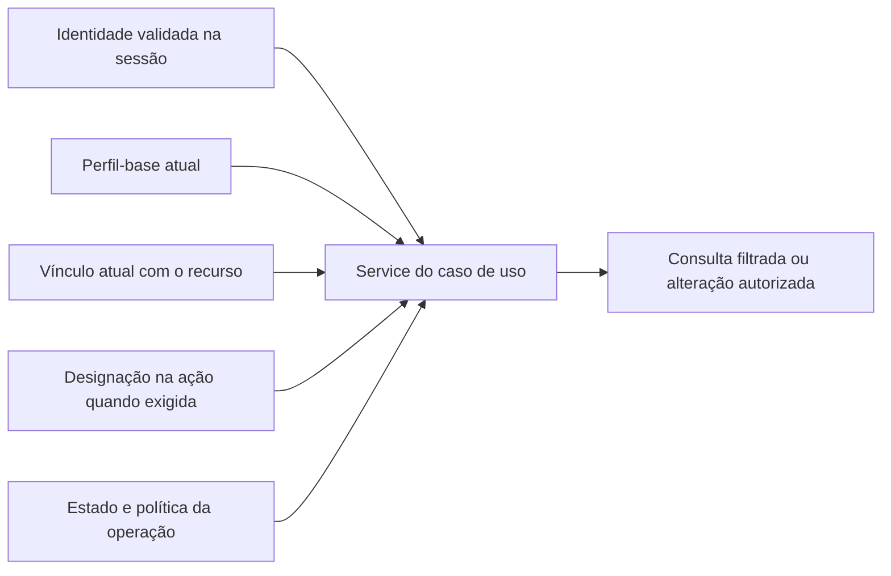

# Spec 0003: Acesso, vínculos e supervisão por ação

- **Status:** Proposto, para revisão; sem implementação.
- **Data:** 10/11/2026. **Etapa:** 6.
- **Produto:** [PRD 0001](../prd/0001-sistema-avaliacao-seguranca-alimentar.md), principalmente RF002, RS001 e RS002; limites de RF016/RF017, RF018/RF022, RS007 e RS010.
- **Base:** [decisões DC005 a DC013 e DC017](../decisoes-confirmadas.md), [arquitetura](../arquitetura.md), [ADR 0005](../adr/0005-autorizacao-contextual-por-acao.md), F003/F008 no [índice](../referencias/README.md).
- **Dependências:** [fundação](0001-fundacao-tecnica.md) e [autenticação](0002-autenticacao.md), ambas Propostas; [pendências](../pendencias.md) P001 a P006, P011/P012, P014, P016/P017 e P020.
- **Rastreabilidade:** [matriz completa do catálogo](../matriz-rastreabilidade.md). Os cenários AC01 a AC36 abaixo são verificações futuras, não resultados de testes.

## Objetivo e recorte

Especificar como o servidor decide quem pode consultar ou executar uma operação, combinando identidade válida, perfil-base, vínculo, contexto e situação atual do recurso. Detalhar gestão de usuários, vínculos de estabelecimento e designações de supervisão, sem transformar uma função contextual em privilégio permanente.

Esta entrega contém contratos candidatos, dados, interfaces de service, rotas, telas, falhas, concorrência e aceite. Não cria código, modelos, banco, migrações ou permissões no Django. Não implementa inspeção, upload, publicação, correção, cancelamento ou auditoria: delimita os controles que esses casos de uso deverão consumir. Não inicia as Etapas 7 ou 8.

## Base confirmada e escolhas abertas

| Tema | Base preservada | O que esta spec não decide |
|---|---|---|
| Perfis-base | Fiscalização, Administrador e Estabelecimento; cliente significa estabelecimento | Perfil único ou múltiplos por conta, representação física e campos adicionais, P002 |
| Supervisor | Fiscal designado para uma ação; atuação contextual, sem quarto perfil | Quem designa/substitui/encerra, quantidade, vigência e ausência, P004 |
| Ação e inspeção | A designação precisa identificar seu escopo | Equivalência ou agrupamento de inspeções, P003 |
| Aprovação | Correção concluída e cancelamento em andamento exigem autorização, justificativa e histórico | Quem aprova, substituição e pedido próprio do supervisor, P005/P006 |
| Estabelecimento | Próprios envios e resultados/documentos finais liberados; sem avaliação interna | Cardinalidade dos vínculos, janela de envio e condições de liberação, P002/P011/P012 |
| Identidade e arquitetura | Usuário customizado, sessão Django, views próprias diretamente de `View`, services sem HTTP | Novas bibliotecas, backend de permissões por objeto, representação por `Group` ou enum persistido |

Os nomes, formatos de retorno, rotas e regras técnicas novos abaixo são **propostas**, não decisões confirmadas. Pendências não são encerradas por documentar uma solução. Até a política aplicável ser escolhida, não existe concessão automática para a operação dependente dela; o comportamento seguro proposto é recusar a concessão e registrar o motivo técnico restrito.

## Modelo lógico de acesso

Quatro perguntas precisam permanecer separadas: quem é o ator, qual sua atuação-base, com quais recursos possui vínculo e qual designação contextual está válida. `is_authenticated`, `is_staff`, `is_superuser`, participação na equipe e conhecimento de um ID não respondem sozinhos às quatro.

O resultado de uma checagem feita para desenhar a tela não é uma autorização reutilizável para o POST seguinte. O service que consulta ou altera o recurso verifica novamente as condições atuais. Não confiar em perfil, autoria, estabelecimento ou resultado `permitido=true` enviado pelo navegador.

O Django fornece grupos e permissões de modelo, mas sua existência não implementa as regras contextuais deste produto. O `ModelBackend` nativo não implementa permissões por objeto; superusuários recebem tratamento amplo nas permissões nativas. Portanto `has_perm()` isolado não substitui a checagem de negócio e não cria exceção sanitária para superusuário. [Permissões nativas](https://docs.djangoproject.com/en/stable/topics/auth/default/#permissions-and-authorization), [referência do backend](https://docs.djangoproject.com/en/stable/ref/contrib/auth/#django.contrib.auth.backends.ModelBackend). Conferir APIs na versão que P001 escolher; esta consulta não seleciona versão ou biblioteca.

## Matriz de papéis e operações

**V:** atuação prevista, sempre sujeita a vínculo/estado e ao contrato da função. **N:** sem concessão por este papel. **P:** política ou recorte ainda pendente; não habilitar por inferência. A coluna Supervisor mostra apenas o efeito adicional da designação; ele mantém a atuação de fiscal.

| Operação | Administrador | Fiscalização | Estabelecimento | Supervisor da ação |
|---|---|---|---|---|
| Manter usuários e perfis-base | V, gestão autorizada RF002 | N | N | N, designação não concede gestão |
| Gerir vínculos com estabelecimento | P, P002 | N | N | N |
| Cadastrar estabelecimentos/checklists e atribuir inspeção | V, RF003/RF004/RF005 | N para essas concessões administrativas | N | Sem acréscimo |
| Iniciar diretamente uma inspeção | Não concedido só pelo perfil administrativo | V, RF006, conforme escopo operacional futuro | N | Como fiscal, sem supervisão automática |
| Preencher checklist e registrar evidências | Não concedido só pelo perfil administrativo | V, acesso à inspeção RF008/RF009 | N | Como fiscal autorizado |
| Consultar inspeção interna/documentos recebidos | P, escopo interno não é irrestrito por inferência | V, recurso no escopo fiscal validado | N para avaliações internas | P/V apenas no escopo autorizado da ação |
| Enviar/consultar documentos próprios do estabelecimento | P para atuação em nome de terceiro | N como origem cliente; consulta fiscal autorizada é distinta | V, vínculo e janela de envio validados | Sem acréscimo |
| Consultar resultado/termo final próprio liberado | P para abrangência administrativa | P/V no escopo interno da função | V, liberação e vínculo atuais | Sem publicação ou liberação automática |
| Designar, substituir ou encerrar supervisor | P, P004 | P, não há autoconcessão | N | P, não recebe poder de designar sucessor automaticamente |
| Solicitar alteração/cancelamento | P para atuar como solicitante | V conforme RF018/RF022 e acesso ao recurso | N neste recorte | Como fiscal; decisão sobre pedido próprio em P005 |
| Aprovar/rejeitar alteração/cancelamento | P, P005 | N apenas por ser fiscal | N | P, P005; designação correta é necessária se for a autoridade escolhida, mas não suficiente para aprovar qualquer ato |
| Aplicar correção ou efetivar cancelamento | P para executor e escopo | P para executor; autorização específica obrigatória | N | P; designação não é autorização genérica de execução |
| Consultar auditoria e decisões internas | P, P017 | P, P017 e escopo | N | P, não equivale a acesso irrestrito |

Os V não aprovam prioridades, fórmulas, categorias de arquivo, modelos documentais ou contratos de funções futuras. Fiscal iniciado diretamente ainda precisa de regra explícita de escopo; P002 não autoriza consultar todas as inspeções. Não resolver múltiplos perfis por união automática de poderes: enquanto P002 estiver aberta, essa combinação não está especificada como concessão.

## Entidades e dados candidatos

O modelo a seguir é **lógico**. Não escolhe nomes de models/tabelas, chaves físicas, cardinalidades ainda abertas ou campos adicionais do usuário. IDs UUID de F003 são referências; seguem P002. Texto, datas e opções são validados no servidor; máscaras ajudam apresentação, não concedem acesso.

### Correspondência completa dos dados de RF002

| Dado da fonte | Tipo de referência | Origem, presença e contrato candidato |
|---|---|---|
| `usuarioId` | UUID | Identidade mantida; referência obrigatória nas alterações, obtida/validada no servidor. Chave física em P002 |
| `nome` | `str` | Entrada na gestão do usuário; proposta de preenchimento não vazio, limite do modelo aprovado. Não dividir automaticamente em `first_name`/`last_name` nem criar `nomeCompleto` sem P002 |
| `identificadorAcesso` | `str` | Nome de usuário, alinhado ao `username` da Spec 0002; obrigatório ao criar, unicidade/normalização conforme modelo aprovado, sem máscara CPF/e-mail presumida |
| `perfil` | Enum | Opções-base Fiscalização, Administrador e Estabelecimento; origem na gestão autorizada. Não aceitar Supervisor como valor. Quantidade por conta e persistência em P002 |
| `fiscalSupervisorId` | UUID | Referência ao fiscal candidato; obrigatória na designação, não é a identidade do executor. Verificar conta ativa, perfil fiscal e elegibilidade que P004 definir |
| `inspecaoId` | UUID | Referência de escopo quando ação equivaler à inspeção; validar existência e autoridade sem expor terceiro |
| `acaoFiscalizacaoId` | UUID condicional | Somente se agrupamento for aprovado em P003. Não exigir os dois campos ou criar ambos como relações definitivas agora |
| `designacaoId` | UUID | Gerado/recuperado pelo servidor; identifica o registro histórico, sem edição manual da chave |
| `designadoPor` | UUID | Ator confiável do servidor, não entrada editável; registrar quem realizou a designação autorizada |
| `inicio/fim` | `datetime` | Instantes com fuso. Momento efetivo e eventual agendamento, retroatividade e fim opcional precisam de P004; datas de registro do ato vêm do servidor |
| `ativa` | `bool` | Situação validada no servidor, não atalho livre de formulário para concessão global; combinar com escopo, vigência e elegibilidade |

Proposta de apresentação de data/hora: `dd/MM/yyyy HH:mm`, preservando o instante com fuso. Fuso de exibição, limites e widgets continuam sujeitos à fundação/P002/P004; não adotar o fuso da máquina como regra. Conta ativa (`is_active`) e designação ativa são conceitos diferentes.

### Vínculos e fatos auxiliares

| Conceito lógico | Dados candidatos e tipos | Invariantes e dependências |
|---|---|---|
| Atuação-base do usuário | Referência ao usuário; código de perfil fechado; situação atual | Não copiar privilégios técnicos para perfil de negócio. Um campo ou associação depende de P002 |
| Vínculo de estabelecimento | Referência ao usuário e estabelecimento; situação; início/fim quando aprovados; ator/momento de concessão e encerramento | P002 decide uma/múltiplas unidades, pessoas por unidade e autoridade de manutenção. Não selecionar o estabelecimento somente por parâmetro do cliente |
| Contexto de fiscalização | Referência estável ao escopo autorizado e relação com a inspeção | P003 decide inspeção isolada versus agrupamento. A expressão contexto nesta spec não cria uma nova entidade de domínio |
| Designação de supervisor | Referências da tabela RF002, situação e história de alterações | Não existe `supervisor: bool` global; não impor unicidade de supervisor por ação enquanto P004 permitir essa dúvida |
| Registro do ato de gestão | Referências do objeto e ator, ação, instante e valores anteriores/novos pertinentes | Histórico preservado sem senha/token; formato, retenção e acesso em P017 e futura spec de auditoria |
| Referência de decisão autorizadora | Solicitação, inspeção, conteúdo autorizado, decisão, autor e contexto aplicáveis | Consome RF018/RF022; não criar autorização genérica para editar tudo nem implementar suas tabelas nesta etapa |

Os dados de RS001 (`usuarioId`, `recursoId`, `acao`, `permitido`) descrevem uma decisão do servidor: referências ao ator/recurso, código de operação e `bool` derivado. Não criar cadastro editável de resultados de permissão. RS002 reutiliza perfil e designação acima, incluindo `fiscalId` como referência ao fiscal designado; não representa outra identidade.

Propostas de integridade para a implementação: referências devem existir; fim não anterior ao início; manter referência histórica de ator/designação; inativar/encerrar sem apagar atos anteriores. Avaliar índices para busca por usuário/perfil, vínculo usuário–estabelecimento e designação fiscal–contexto–vigência. Restrições físicas, exclusão protegida, tipos e índices exatos dependem do schema aprovado; não criar unicidade parcial de uma designação ativa por ação antes de P004.

## Contratos dos services

Os nomes abaixo representam operações candidatas, não classes obrigatórias. Entradas/saídas são valores ou estruturas de dados sem `request`/`HttpResponse`. O ator é obtido da sessão pela view; o service revalida sua situação, vínculos e regra pertinente. Consultas explícitas da aplicação ao ORM ficam no service.

| Operação candidata | Entradas | Saída e efeitos autorizáveis |
|---|---|---|
| Consultar usuários gerenciáveis | Ator, filtros permitidos e paginação validada | Lista mínima filtrada; sem hash, sessão, segredos ou dados fora do escopo; limite/paginação ainda a aprovar |
| Manter usuário/perfil | Ator, dados validados, referência e versão esperada quando houver edição | Criar/alterar somente campos permitidos; preservar histórico e não conceder poderes técnicos. Criação/entrega de credencial depende de P014, sem senha-padrão inventada |
| Consultar/manter vínculo | Ator, usuário e estabelecimento, operação pretendida e dados validados | Acesso somente pela autoridade que P002 definir; encerrar preservando o vínculo anterior |
| Consultar equipe/designações | Ator e contexto validado | Dados de fiscalização mínimos autorizados; estabelecimento não obtém gestão de usuários ou deliberação interna |
| Designar/substituir/encerrar supervisão | Ator, fiscal, contexto, operação, vigência aprovada e referência atual | Validar autoridade P004, elegibilidade, estado e concorrência; conservar registro anterior e autoria |
| Avaliar acesso ao recurso | Ator, operação do domínio e referência do recurso | Resultado lógico permitido/negado/política não definida, com motivo técnico restrito; não é token reutilizável nem autorização emitida pelo cliente |
| Consultar resultado/arquivo acessível | Ator, recurso, filtros/versão admissíveis | Retornar somente objeto/arquivo autorizado; aplicação futura de RF016/RS010 ainda depende de liberação e entrega privada |

Proposta: motivos internos distinguem identidade inválida, perfil, vínculo, contexto, vigência, estado, política indefinida e conflito. A mensagem pública não precisa revelar essa diferença nem a existência do recurso. Erro de banco não vira decisão `permitido=true` ou resultado parcial.

Os services de inspeção/correção/cancelamento devem chamar o controle contextual dentro do mesmo caso de uso que produz o efeito. Não basta a view verificar previamente e depois um service executar sem autorização. Compartilhar consulta de regra não significa criar uma camada genérica de permissões, biblioteca externa, DSL ou backend customizado nesta fase.

## Fluxos de gestão e supervisão

### Manter usuário e perfil

1. Ator autenticado solicita a gestão; service verifica a concessão administrativa pertinente. A página e o POST repetem o controle.
2. Form aceita apenas os campos aprovados; perfil possui três opções-base. Flags técnicas, autoria e referências históricas não são editáveis livremente.
3. Service valida identidade, unicidade conforme modelo e limites de concessão. Autoelevação, combinação de perfis, último administrador e criação de credencial dependem das políticas P002/P014, sem soluções presumidas.
4. Alteração aprovada é gravada com contexto histórico pertinente. Inativação ou mudança de perfil deve refletir nas operações seguintes, inclusive na sessão já aberta, sem exigir logout manual.
5. Não eliminar usuário referenciado por atos oficiais. O mecanismo físico de preservação será escolhido com o schema/auditoria; não trocar o autor de um ato antigo ao atualizar o cadastro.

### Designar e substituir supervisor

1. Resolver contexto conforme P003 e recuperar fiscal/equipe autorizados. Participar da equipe ou iniciar a inspeção não designa supervisor.
2. Verificar se a política P004 definiu autoridade, quantidade e vigência. Ausência de definição não concede designação ao Administrador ou ao próprio fiscal.
3. Validar dados, elegibilidade do fiscal e autorização do ator. Referência de outro contexto não é aceita pelo fato de o fiscal existir.
4. Gravar concessão/substituição/encerramento com autoria e história. Proposta: mudanças de vigência não reescrevem retroativamente a autoria de decisões anteriores.
5. A próxima decisão usa a designação atual válida. Se uma operação concorrente alterar a designação, a efetivação precisa revalidar sua condição antes de aplicar o efeito.

Proposta de cálculo de vigência quando houver período: início inclusivo e fim exclusivo, usando instante do servidor; ausência de fim só representa período aberto se P004 aceitar. `ativa=true` com início futuro, fim vencido, fiscal inativo ou contexto diferente não basta para autorizar. Não fixar validade em dias/horas nem aceitar retroatividade por padrão.

### Autorização para correção/cancelamento

RF018 e RF022 continuam separando solicitação, decisão e efetivação. Esta spec define apenas o contrato de acesso: solicitante autorizado; autoridade competente; designação válida na ação quando exigida; conteúdo e inspeção exatos; estado e decisão revalidados na aplicação. P005 não está resolvida, inclusive para solicitação feita pelo próprio Supervisor.

Proposta de tratamento enquanto houver política indefinida: operação dependente permanece indisponível para concessão; não escolher autoaprovação nem substituto automático. Se a autoridade for definida posteriormente, aplicar somente a mudança aprovada. Aprovação de outra inspeção, outro conteúdo ou outra ação não autoriza. Rejeição/pendência não cancela nem reabre inspeção; P006 decide bloqueio durante análise.

## Consultas e arquivos do estabelecimento

Toda lista, contagem, filtro, detalhe, busca, galeria, exportação e download deve partir do conjunto acessível ao usuário. Não carregar um conjunto global e filtrar apenas no template. Caso uma conta tenha múltiplas unidades no modelo futuro, a unidade escolhida precisa continuar dentro do vínculo validado; seleção não cria vínculo.

Resultado final próprio só é retornado depois da liberação; conclusão da inspeção não implica publicação. Termos mantêm a versão autorizada. Documentos próprios enviados seguem a janela de envio validada, sem liberar checklist em andamento, decisões internas ou evidência fiscal. Novo anexo não altera a nota nem inicia reanálise automaticamente.

Referências de arquivo devem ser resolvidas pelo servidor em relação ao objeto acessível. Não aceitar caminho de armazenamento do cliente nem liberar arquivo interno por URL conhecida. Acesso a uma versão não presume acesso a todas as versões; política de consulta histórica/liberação em P012. Armazenamento, link temporário, streaming e validação de arquivo pertencem a P016/specs futuras.

## HTTP, forms e telas candidatos

Namespace candidato `contas` para gestão de identidade; views próprias herdam diretamente de `View`, com mixins de acesso admitidos. Tokens `<usuario_ref>`, `<vinculo_ref>` e `<contexto_ref>` abaixo indicam referências opacas cuja forma depende de P002/P003; não escolher conversor UUID ou chave inteira agora.

| Rota candidata / nome | Métodos e view candidata | Acesso e resposta |
|---|---|---|
| `/gestao/usuarios/` — `contas:usuarios` | GET, `UsuariosView(View)` | Gestão autorizada; 200 lista filtrada/paginada, sem credenciais |
| `/gestao/usuarios/novo/` — `contas:usuario_criar` | GET/POST, `UsuarioCriarView(View)` | Autoridade de gestão; GET form, POST inválido 200, sucesso 302; criação de credencial bloqueada pela política aplicável |
| `/gestao/usuarios/<usuario_ref>/` — `contas:usuario_editar` | GET/POST, `UsuarioEditarView(View)` | Campos permitidos e alvo no escopo; mesma validação no POST; flags técnicas indisponíveis |
| `/gestao/vinculos/` — `contas:vinculos` | GET/POST, `VinculosView(View)` | Apenas após P002 definir autoridade/representação; 200 consulta/form, 302 após mutação válida |
| `/gestao/vinculos/<vinculo_ref>/encerrar/` — `contas:vinculo_encerrar` | POST, `VinculoEncerrarView(View)` | Autoridade aprovada; preservar história; não apagar por GET |
| `/gestao/supervisao/<contexto_ref>/` — `contas:supervisao` | GET/POST, `SupervisaoView(View)` | Consulta/gestão com escopo; mutações somente após P003/P004; sucesso 302 |
| `/gestao/supervisao/<contexto_ref>/encerrar/` — `contas:supervisao_encerrar` | POST, `SupervisaoEncerrarView(View)` | Autoridade e designação atual validadas; não retirar outra designação por manipulação da referência |

Rotas são propostas para futura implementação, não recursos publicados. Não criar rotas de aprovar correção/cancelamento, reanálise, upload ou PDF nesta entrega. GET/HEAD não alteram estado; OPTIONS, se admitido, só informa métodos. POSTs exigem CSRF, inclusive por chamadas diretas. Sem autenticação, solicitar entrada conforme Spec 0002; nunca reenviar silenciosamente um POST depois do login.

Forms candidatos: gestão de usuário, vínculo e supervisão, com listas filtradas e campos ocultos tratados como entrada não confiável. Validar referência e poder de atuação no service novamente. Limites de texto, filtro/paginação e instante/vigência devem ser os aprovados, sem tamanhos inventados. Não usar `ModelForm.save()` como atalho que ignore histórico/autorização.

Telas propostas mostram perfil-base separado da função contextual, contexto da designação, responsável/momento e histórico acessível. Botões de gestão/decisão só aparecem quando cabíveis, mas sua ausência não é controle de acesso. Confirmar mutação somente após servidor; conflito preserva o preenchimento da página aberta sem reaplicar concessão. Não apresentar aprovar/encerrar como habilitado enquanto a política correspondente não estiver definida.

## Falhas e respostas propostas

| Condição | Contrato observável | Preservação |
|---|---|---|
| Sessão ausente/inválida | Redirecionamento para entrada nas páginas HTML, conforme Spec 0002 | Sem conteúdo protegido ou repetição automática de POST |
| Referência inexistente ou fora do conjunto acessível | 404 com mensagem genérica equivalente | Sem revelar nome, vínculo, estado ou existência de terceiro |
| Recurso acessível, operação não concedida | 403 genérico | Nenhum efeito ou informação interna de política |
| Política necessária ainda indefinida | 403/ação indisponível, sem concessão; motivo técnico restrito | Não preencher autoridade ou cardinalidade por inferência |
| Formato, obrigatório ou opção inválida | 200 com erros no form; 404 para referência inválida na rota | Nenhuma gravação parcial; entrada segura preservada |
| CSRF inválido | 403 antes de executar a operação | Sem mutação ou exposição de token em erro/log |
| Estado/vínculo/designação mudou entre leitura e gravação | 409 após autorização aplicável; orientar atualização | Preservar contexto, não sobrescrever história ou aplicar concessão antiga |
| Banco/falha operacional reconhecida | 503 quando mapeada; inesperada 500 sanitizado | Não permitir acesso por falha de consulta; sem segredos no erro |
| Método não aceito | 405 quando alcançado o despacho da view | Controles anteriores de CSRF/acesso continuam válidos; sem efeito de leitura |

Proposta de ordem: validar identidade, formato e conjunto acessível; só então informar falha de operação/estado que o ator possa conhecer. Negativas não revelam se o recurso existe fora do conjunto acessível. Logs/auditoria diferenciam motivo quando permitido por P017, sem senha, sessão, token, conteúdo fiscal completo ou resposta interna entregue ao estabelecimento.

## Consistência, revogação e Admin

Proposta: o caso de uso delimita transação para alteração de usuário/vínculo/designação e seu registro histórico obrigatório. Revalidar autoridade, elegibilidade, vigência e versão/estado antes da escrita; escolher bloqueio/revisão e restrições após schema aprovado. `atomic` sozinho não impede duas designações incompatíveis, e a regra de compatibilidade depende de P004. Não impor unicidade ainda não decidida.

Acesso posterior à revogação não pode depender de um perfil ou designação copiados na sessão no momento do login. Evitar cache de autorização sem invalidação definida. Para corrida entre revogação e ato oficial, a implementação futura deverá ordenar os atos no ponto de efetivação com mecanismo explícito e testar os dois caminhos; não prometer cancelar requisição já efetivada.

Repetição de mutação após resposta perdida não deve conceder duas vezes ou gerar encerramentos contraditórios. Identificação de operação, prazo de reconhecimento e conflito de conteúdo ficam em P020; redirecionar ou desabilitar botão não resolve duplicidade concorrente. A confirmação depende do servidor, preservando a página aberta enquanto não houver resultado confirmado.

Admin e futuras entradas técnicas usam os mesmos services para atos de negócio. Flags nativas não dispensam vínculo/escopo; esconder campos sem proteger o POST não é suficiente. Não registrar modelos críticos com edição/exclusão direta até integração explícita que evite segunda gravação automática. Procedimentos excepcionais de suporte precisam de política própria; não inventar acesso de emergência.

## Bloqueios e decisões de revisão

| Decisão | Parte afetada | Condição antes de executar |
|---|---|---|
| P001/P002 | Models, perfis, credenciais e vínculos | Validar versões/chaves/campos, combinação de perfis, cardinalidades, autoridade de gestão e bootstrap sem autoelevação |
| P003 | Escopo e relacionamentos da supervisão | Definir ação versus inspeção antes de criar FK, rotas resolvíveis e restrições físicas |
| P004 | Designação, quantidade, vigência e substituição | Validar autoridade, elegibilidade, sobreposição, ausência e retroatividade; não adotar intervalo proposto sem revisão |
| P005/P006 | Aprovação, pedido próprio e alterações em andamento | Definir autoridade, substituição, autoaprovação e eventual bloqueio de edição |
| P011/P012/P016 | Envio, publicação e acesso a documentos | Escolher janelas, liberação e entrega privada antes dos fluxos funcionais |
| P014/P017/P020 | Identidade, história, revogação e retentativa | Definir políticas aplicáveis, acesso/retenção e recuperação de operações |

Os contratos são revisáveis, mas a implementação integral não está pronta enquanto seus bloqueios aplicáveis permanecerem abertos. Não encerrar todas as pendências pela aprovação de uma matriz de papéis. Propostas de dados não mudam o catálogo nem registram novas decisões confirmadas.

## Critérios de aceite futuros

Todos os cenários são planejados e não executados. Usar contas/estabelecimentos/contextos fictícios A e B, datas controladas, sessão real no teste de HTTP e PostgreSQL isolado nas verificações de persistência/concorrência. Políticas escolhidas devem constar da evidência; não criar uma política de produto para conseguir marcar o teste como passado.

| ID | Cenário | Resultado observável |
|---|---|---|
| AC01 | Tentar todas as operações sem identidade e com conta inativa | Nenhuma consulta/mutação protegida; retomada conforme autenticação |
| AC02 | Usuário sem concessão abre gestão e envia POST direto | Negativa no servidor, sem dados de usuários ou efeito |
| AC03 | Gestão autorizada mantém usuário/perfil com campos aprovados | Registro correto; nenhuma flag técnica ou designação concedida pelo perfil |
| AC04 | Enviar perfil Supervisor, código desconhecido, staff/superusuário e ator falsificado | Não conceder esses poderes; autoria real vem do servidor |
| AC05 | Omitir nome/identificador obrigatório, repetir identificador ou ultrapassar limite aprovado | Erros coerentes sem gravação parcial ou alteração indevida de credencial |
| AC06 | Alterar/inativar conta já autenticada e fazer nova operação | Revalidar acesso atual; ato anterior conserva autor histórico |
| AC07 | Testar combinação de perfis, autoelevação e bootstrap administrativo | Somente conforme política P002 aprovada; não adotar união automática |
| AC08 | Estabelecimento A lista/busca/conta/exporta resultados | Somente conjunto próprio liberado; contagens não revelam B |
| AC09 | A abre detalhe/referência de inspeção de B e referência inexistente | Mesma negativa pública sem conteúdo ou indicação de existência |
| AC10 | Estabelecimento tenta resultado em elaboração, concluído não liberado e final próprio liberado | Só o último é acessível |
| AC11 | Consultar termo/arquivo por URL direta, outra versão e recurso de B | Revalidar objeto, versão e liberação; nenhum arquivo interno exposto |
| AC12 | Enviar documento próprio durante janela aprovada e tentar envio para B | Só envio autorizado; não liberar checklist nem mudar nota |
| AC13 | Selecionar unidade sem vínculo, inclusive em conta com múltiplos vínculos se aprovada | Seleção não cria acesso; todas as referências continuam filtradas |
| AC14 | Revogar vínculo e repetir consulta/download na mesma sessão | Acesso seguinte recusado sem exigir logout manual |
| AC15 | Fiscal participa/inicia inspeção sem designação | Não recebe supervisão automaticamente |
| AC16 | Autoridade aprovada designa fiscal ativo e elegível no contexto A | Escopo e história identificáveis, sem permissão global |
| AC17 | Fiscal/Supervisor sem autoridade designa a si ou a outro por POST adulterado | Nenhuma concessão; não basta enviar `ativa=true` |
| AC18 | Supervisor A tenta decidir no contexto B | Negativa; designação de A não se estende a B |
| AC19 | Testar início futuro, fim vencido e fronteira exata do período | Vigência segue a política aprovada e instante do servidor |
| AC20 | Fiscal designado perde perfil/atividade/elegibilidade | Designação anterior não autoriza nova decisão incompatível |
| AC21 | Substituir/encerrar designação e repetir ato na mesma sessão | Novo acesso usa situação atual; histórico anterior preservado |
| AC22 | Duas gestões concorrentes tentam designações incompatíveis | Resultado respeita cardinalidade aprovada; sem duplicidade silenciosa ou perda de história |
| AC23 | Revogar designação entre tela e efetivação de decisão | Controle na efetivação impede usar autorização desatualizada; ordenar concorrência e registrar resultado |
| AC24 | Autoridade, agrupamento ou autoaprovação sem política definida | Nenhuma concessão por inferência; diagnóstico restrito |
| AC25 | Pedido pendente/rejeitado tenta executar correção/cancelamento | Nenhum efeito oficial nem mudança indevida de estado |
| AC26 | Usar aprovação de outra inspeção, conteúdo ou contexto | Não autoriza o efeito; aprovação não é edição irrestrita |
| AC27 | Supervisor solicita mudança e tenta decidir seu próprio pedido | Comportamento somente após P005; enquanto indefinida, sem autoaprovação |
| AC28 | Aprovação válida é consumida pelo fluxo funcional futuro | Somente efeito autorizado, histórico e versões preservados; validar na spec funcional, não declarar implementado aqui |
| AC29 | Tentar os mesmos atos via Admin/entrada técnica | Mesmas invariantes; flag técnica não concede autoridade de negócio |
| AC30 | CSRF inválido e GET/HEAD nas ações de encerramento | Sem mutação; métodos e respostas respeitam a ordem dos controles |
| AC31 | Perfil/vínculo/designação mudam após checagem usada pela tela | POST e service revalidam; controle visual não é a única proteção |
| AC32 | Falha de banco durante gestão ou gravação do histórico obrigatório | Sem concessão parcial/abertura por falha; resposta sanitizada |
| AC33 | Confirmar gestão, perder resposta e reenviar, inclusive concorrentemente | Uma alteração coerente conforme mecanismo P020 aprovado; não criar outra concessão |
| AC34 | Inspecionar listas, erros, logs e histórico com dados de teste | Sem hash/senha/tokens ou deliberação interna ao estabelecimento; ator/momento corretos |
| AC35 | Encerrar vínculo/designação e tentar excluir usuário referenciado | História continua íntegra conforme restrições aprovadas; sem cascata destrutiva |
| AC36 | Revisar forms, views, services, modelos e tabelas futuras | Limites da arquitetura respeitados; sem quarto perfil, booleano global Supervisor, tabela de sessão duplicada ou novos modelos funcionais antecipados |

- [ ] Políticas bloqueantes e contratos novos revisados, com origem e data.
- [ ] Cenários aplicáveis executados em ambiente isolado, com evidência e limitações reais.
- [ ] Testes de acesso negativo, revogação e concorrência demonstrados nas entradas efetivas.
- [ ] Nenhum RF/RNF/RS marcado como implementado pela existência desta documentação.

## Continuidade

Revisar esta spec e a matriz de rastreabilidade, resolver as pendências antes da parte de implementação dependente e manter fontes/IDs. A [revisão integrada das skills](../revisao-skills-tecnicas.md) foi realizada na Etapa 7. As orientações da raiz e a [revisão final](../revisao-final-fundacao.md) foram elaboradas na Etapa 8; qualquer nova atividade depende do recorte solicitado, sem implementação automática. [Estado](../state.md), [etapas](../etapas.md) e [Trello](../acompanhamento-trello.md) guardam a retomada.
